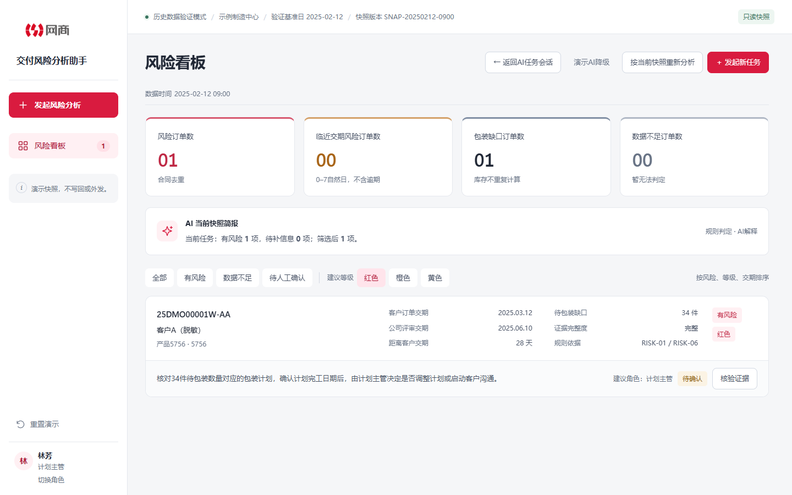
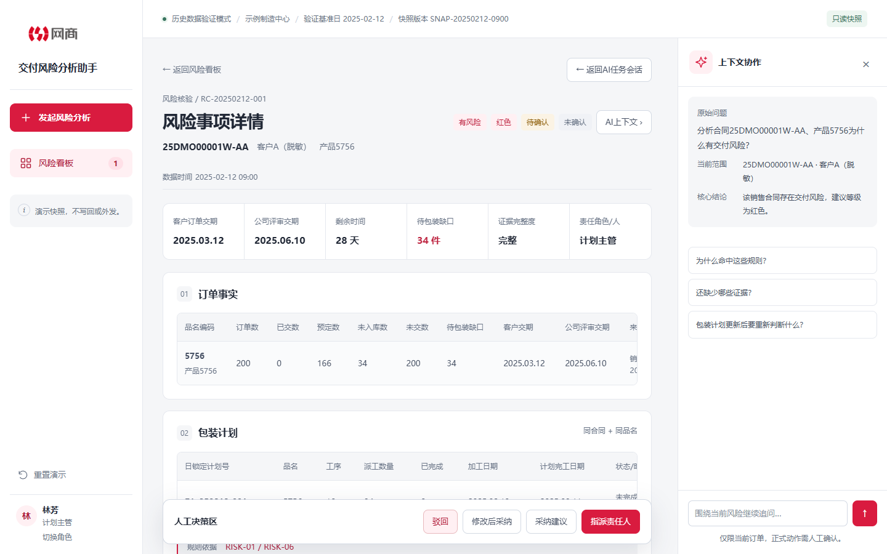

# 订单交付风险分析助手

面向制造业计划人员，将订单事实、包装计划和工单预警汇总为可核对的交付风险事项，帮助用户完成“发现风险 → 查看证据 → 人工确认 → 分派处理”。

**定位：可运行的 AI 产品交互原型。** 使用脱敏模拟快照，风险计算和回答均由本地规则生成；当前未接入真实大模型、ERP 或 MES。



## 可以体验什么

- 用自然语言或查询条件发起分析，并继续追问规则、缺失信息和建议。
- 在风险看板筛选事项，查看订单数量、交期、风险等级与状态。
- 展开详情，核对规则命中、证据来源及待补信息。
- 演示修改建议、人工采纳、指派处理、角色权限与 AI 降级。

关键设计是把**确定性事实、原因候选、AI 建议和人工决策**分开。缺少证据时保留已知事实，不把候选原因说成已确认根因。

## 本地运行

需要 Python 3。在仓库根目录执行：

```bash
python -m http.server 4173 --bind 127.0.0.1
```

打开 <http://127.0.0.1:4173/>。Windows 也可双击 `启动原型.bat`。

推荐演示：输入“分析合同25DMO00001W-AA、产品5756为什么有交付风险？”→ 追问“为什么命中这些规则？”→ 打开看板和详情 → 修改后采纳并指派。固定快照基准日为 `2025-02-12`，页面中的日期不是实时数据。



## 产品设计与验证

[产品设计说明](docs/product-design.md)介绍用户问题、MVP 取舍、可信度边界和演示路径；[验证记录](docs/verification.md)记录本次作品集副本的实际检查。

```bash
npm ci
npm test
npm run test:browser
```

浏览器检查默认使用 Windows 上安装的 Chrome，可用 `CHROME_PATH` 指定浏览器路径。单元测试覆盖风险计算、权限、状态机、上下文隔离和错误恢复。

## 代码结构

```text
index.html           页面入口
styles.css           基础样式
workspace.css        企业工作台主题
js/fixtures.js       模拟快照
js/rules.js          确定性风险规则
js/state.js          状态机、权限与操作记录
js/assistant.js      模拟问答与追问
js/views.js          页面渲染
js/app.js            事件协调
tests/               单元与浏览器检查
docs/                产品说明与截图
```

所有操作只改变浏览器内存，刷新或重置后恢复。尚未实现真实消息外发、业务写回和上线后的效果统计。此仓库是独立展示副本，不包含原工程的密钥、内部资料和日期分组目录。
